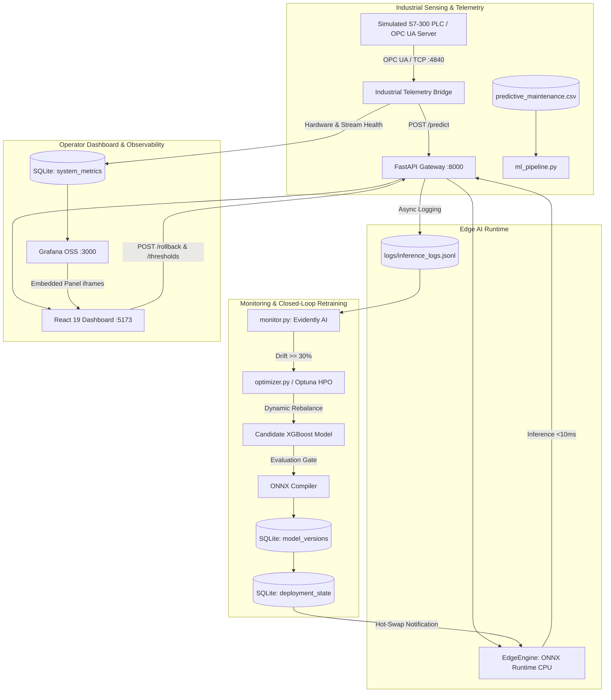

# ⚡ EdgeOps AI Platform

> **Production-Grade Closed-Loop MLOps for Predictive Maintenance at the Industrial Edge**

[](https://www.python.org/)
[](https://fastapi.tiangolo.com/)
[](https://onnxruntime.ai/)
[](https://www.evidentlyai.com/)
[](https://react.dev/)
[](https://www.docker.com/)

---

## 🏭 Overview

The **EdgeOps AI Platform** is an autonomous, self-healing MLOps system tailored for predictive maintenance in industrial automation settings (such as CNC machines, milling centers, and motor drives connected to Siemens SIMATIC S7-300 PLCs and Siemens Industrial Edge devices).

### Core Features
- **Ultra-Low Latency Inference (<10 ms):** Serves XGBoost models compiled into **ONNX** format executed via **ONNX Runtime** on CPU-constrained edge hardware.
- **Continuous Statistical Drift Monitoring:** Uses **Evidently AI** (Population Stability Index & Kolmogorov-Smirnov metrics) to monitor real-time sensor streams without requiring immediate ground-truth failure labels.
- **Autonomous Self-Healing Retraining:** When feature drift $\ge 30\%$, the system automatically spins up a multi-tiered retraining tournament featuring **Optuna Bayesian optimization** and dynamic class-imbalance reweighting.
- **Dual-Model Atomic Rollback:** A singleton database state pointer (`deployment_state`) tracks both active (`current_model_id`) and fallback (`stable_model_id`) versions, enabling instantaneous (<2s) zero-downtime rollback if a retrained model degrades.
- **Industrial Operator Cockpit:** A React 19 single-page dashboard featuring 1-second live polling, interactive threshold JSON tuning, CSV alert exporting, WebAudio acoustic sirens (sawtooth 550–880 Hz), and embedded Grafana panels.
- **Industrial Protocol Integration:** Includes a simulated **OPC UA** telemetry server (`asyncua`) and PLC connector bridge mimicking real factory sensor cycles.

---

## 🏛️ System Architecture



---

## 📁 Repository Structure

```
AI at edge/
├── config.py                 # Central configuration, file paths, thresholds, auth
├── database.py               # SQLite registry API & schema management
├── schema.sql                # SQL DDL for model_versions, deployment_state, system_metrics
├── edgeops.db                # SQLite database with active model & metrics
├── mlflow_tracking.db        # MLflow experiment tracking SQLite database
├── edge_engine.py            # Persistent in-memory ONNX Runtime inference engine
├── api.py                    # FastAPI REST application & endpoints
├── ml_pipeline.py            # Model training, dynamic reweighting, ONNX export, MLflow
├── optimizer.py              # Self-healing HPO loop (Optuna) and deduplication
├── monitor.py                # Statistical data drift evaluator (Evidently AI)
├── monitor_realtime.py       # 3-tier operational limits & anomaly evaluator
├── data_streamer.py          # Real-time background telemetry streamer
├── industrial/               # P3: Industrial Automation & PLC Connectivity
│   ├── opc_ua_plc_server.py  # IEC 62541 OPC UA server exposing S7 DB1 tags
│   └── plc_bridge_client.py  # Edge bridge querying Edge AI & setting fault trips
├── requirements.txt          # Pinned Python package dependencies
├── .env.example              # Template environment configuration
├── Makefile                  # Automation makefile for setup, test, and run
├── start_all.ps1             # PowerShell script to launch full stack on Windows
├── start_all.sh              # Bash script to launch full stack on Linux/macOS
├── docker-compose.yml        # Orchestration for Backend, Frontend, Grafana
├── dockerfile                # Python backend container definition
├── edgeops-dashboard/        # Modern React 19 + Vite frontend
├── experiments/              # P1 empirical benchmark scripts and data
├── results/                  # P1 measured outputs, plots, and CSV tables
├── tests/                    # Pytest test suite for API, DB, drift, and rollback
└── docs/                     # Academic documentation, architecture, viva prep
    ├── PROJECT_UNDERSTANDING.md
    ├── ACADEMIC_REPORT.md
    └── viva_prep.md
```

---

## 🚀 Getting Started

### 1. Prerequisites
- **Python 3.9+** (Tested on Python 3.9, 3.12, and 3.14)
- **Node.js 18+** & **npm**
- **Docker Desktop** (Optional, for containerized Grafana & stack deployment)

### 2. Environment Setup
```bash
# Clone the repository
git clone <repo-url>
cd "AI at edge"

# Create virtual environment (recommended)
python -m venv .venv
# Windows:
.venv\Scripts\activate
# Linux/macOS:
source .venv/bin/activate

# Install pinned Python dependencies
pip install -r requirements.txt

# Install frontend dependencies
cd edgeops-dashboard
npm install
cd ..

# Copy environment configuration
cp .env.example .env
```

### 3. Launching the System

#### Option A: Windows PowerShell Launcher (Recommended on Windows)
```powershell
.\start_all.ps1
```

#### Option B: Linux / macOS Launcher
```bash
chmod +x start_all.sh
./start_all.sh
```

#### Option C: Docker Compose
```bash
docker compose up --build -d
```

#### Option D: Manual Service Execution (PowerShell / Terminal)
```powershell
# Terminal 1: FastAPI Backend & Edge AI Runtime
python -m uvicorn api:app --host 127.0.0.1 --port 8000 --reload

# Terminal 2: React Dashboard
npm run dev --prefix edgeops-dashboard

# Terminal 3 (Optional Industrial PLC Simulation):
python industrial/opc_ua_plc_server.py

# Terminal 4 (Optional Industrial Bridge to Edge AI):
python industrial/plc_bridge_client.py
```

---

## 🌐 Endpoints & API Reference

| Method | Endpoint | Description | Auth Required |
|---|---|---|---|
| `GET` | `/health` | Node health & active model version | No |
| `POST` | `/predict` | Live sensor inference (<10ms ONNX execution) | No |
| `GET` | `/dashboard/registry` | All registered model versions & metrics | No |
| `GET` | `/dashboard/state` | Singleton deployment state (current & stable) | No |
| `GET` | `/dashboard/drift` | Latest Evidently AI drift status | No |
| `GET` | `/alerts` | Real-time threshold anomaly alerts | No |
| `POST` | `/alerts/clear` | Purges alert history & reset siren | No |
| `GET` | `/stream/status` | Live status of background telemetry | No |
| `POST` | `/stream/start` | Starts continuous 1-second telemetry stream | No |
| `POST` | `/stream/stop` | Pauses continuous telemetry stream | No |
| `GET` | `/thresholds` | Current 3-tier operational limits (JSON) | No |
| `POST` | `/thresholds` | Save manual threshold overrides | **Yes (Basic Auth)** |
| `POST` | `/run_pipeline` | Triggers initial schema assembly & base training | No |
| `POST` | `/force_optimization`| Bypasses drift gating to run Optuna retraining | No |
| `POST` | `/hard_reset` | Logs maintenance hardware event & clears baseline | **Yes (Basic Auth)** |
| `POST` | `/rollback` | Reverts active pointer to stable fallback model | **Yes (Basic Auth)** |

*Default Admin Credentials:* `admin` / `edgeops2026` (configurable via `.env`).

---

## 🧪 Experiments & Empirical Verification (P1 & P5)

All benchmark scripts, seeds, and measured artifacts are located in `experiments/` and `results/`:
- **Model Comparison (`experiments/exp1_model_comparison.py`):** 5-fold Stratified CV comparing XGBoost vs. Random Forest vs. Logistic Regression with class-imbalance weighting, PR-AUC, ROC-AUC, and SHAP feature importance.
- **Optuna Ablation (`experiments/exp2_optuna_ablation.py`):** Quantitative study of default hyperparameters vs. Bayesian TPE optimization (30 trials).
- **Controlled Drift Study (`experiments/exp3_drift_study.py`):** Injection of 0.5–3.0 SD shifts on torque and temperature, measuring detection latency, false alarm rates, and retraining recovery across thresholds (10% to 50%).
- **Edge Inference Benchmark (`experiments/exp4_edge_benchmark.py`):** Measured latency (p50/p95), RAM/CPU utilization, and model binary footprint comparing native XGBoost vs. ONNX Runtime on CPU (55.8x speedup).
- **Reliability Benchmark (`experiments/exp5_reliability_benchmark.py`):** Measured rollback transition time (mean 27.9 ms) and hard-reset recovery latency (2.6 ms) under live load.
- **NASA C-MAPSS Generalization (`experiments/exp6_cmapss_generalization.py`):** 20,631 records across 100 turbofan engines, 5-Fold GroupKFold evaluating cross-domain transferability (ROC-AUC 0.9891, Recall 92.1%).

---

## 🛠️ Testing & Quality Assurance (P2)

Run the full test suite:
```bash
pytest tests/ -v
```

Run Locust load test (simulate 50 edge telemetry clients):
```bash
locust -f tests/locustfile.py --headless -u 50 -r 10 --run-time 1m --host http://127.0.0.1:8000
```
