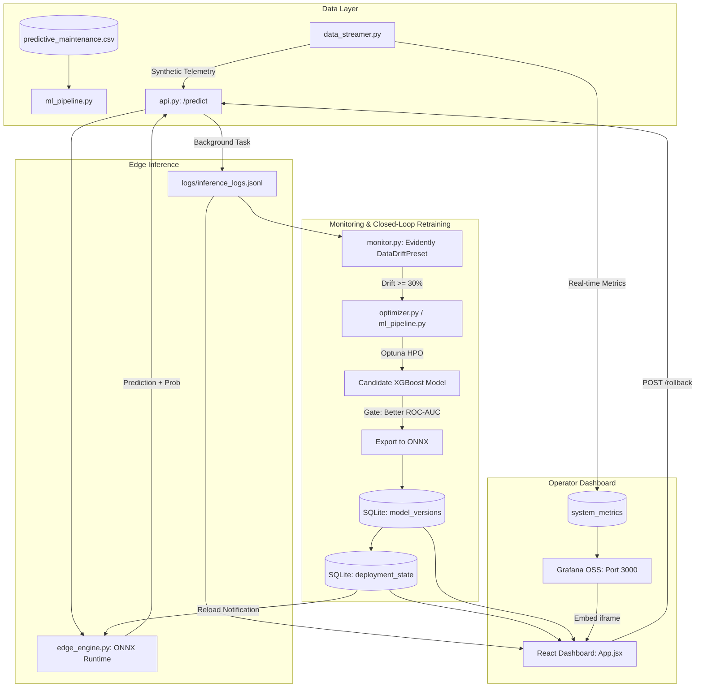

# EdgeOps AI Platform: Comprehensive Project Understanding & Codebase Audit

**Date:** October 2026  
**Auditor:** Senior ML/MLOps Engineer  
**Repository:** EdgeOps AI Platform (`c:\Users\vansh\OneDrive\Desktop\AI at edge`)  
**Context:** Industrial Predictive Maintenance at the Edge (Siemens S7-300 / Industrial Edge Context)  

---

## 1. Executive Summary & Purpose

The **EdgeOps AI Platform** is a closed-loop Machine Learning Operations (MLOps) system designed for predictive maintenance of industrial equipment running at the manufacturing edge. In factory environments (such as machining centers, CNC milling stations, or assembly lines controlled by PLCs like the Siemens SIMATIC S7-300 and Siemens Industrial Edge devices), unexpected equipment failure leads to catastrophic production halts.

Traditional maintenance approaches operate either **reactively** (repairing after breakdown) or **preventively** (replacing components on static, time-based intervals). The EdgeOps AI Platform implements **predictive maintenance (PdM)** on edge devices by:
1. Ingesting high-frequency multivariate telemetry (temperatures, rotational speed, torque, tool wear).
2. Performing local edge inference using an ONNX-compiled classifier under tight latency bounds (<10 ms).
3. Continuously profiling inbound data distributions for statistical data drift using Evidently AI.
4. Autonomously triggering self-healing retraining loops (with Optuna Bayesian hyperparameter optimization and dynamic class-imbalance reweighting) when drift exceeds a calibrated threshold ($\ge 30\%$).
5. Managing a persistent dual-pointer model registry in SQLite that supports zero-downtime hot-swapping and deterministic 1-click model rollback.
6. Presenting operational health to machine operators through a React-based control dashboard featuring WebAudio acoustic alerting, dynamic threshold configuration, CSV export, and embedded Grafana telemetry.

---

## 2. Repository Structure & Artifact Layout

```
AI at edge/
├── config.py                      # Global path configuration, hyperparams, MLOps thresholds
├── database.py                    # SQLite registry API: versioning, promotion, state transitions
├── schema.sql                     # DDL for model_versions, deployment_state, system_metrics
├── edgeops.db                     # Primary SQLite registry and telemetry metrics database
├── mlflow_tracking.db             # MLflow SQLite backend store
├── edge_engine.py                 # ONNX Runtime persistent inference engine singleton
├── api.py                         # FastAPI backend REST application & background logging
├── ml_pipeline.py                 # Core ML training, evaluation, ONNX export, MLflow logging
├── optimizer.py                   # Self-healing retraining engine, HPO, model tournament
├── monitor.py                     # Evidently AI statistical drift detection engine
├── monitor_realtime.py            # 3-tier dynamic operational envelope threshold evaluator
├── data_streamer.py               # Simulated IoT telemetry generator & drift injector
├── dashboard.py                   # Legacy Streamlit prototype interface
├── predictive_maintenance.csv     # AI4I 2020 predictive maintenance baseline dataset
├── sensor_thresholds.json         # Learned operational sensor thresholds (mean, std, tiers)
├── baseline_reset.txt             # Flag file for tracking maintenance hardware resets
├── requirements.txt               # Python package dependencies
├── dockerfile                     # Python 3.9 backend container definition
├── docker-compose.yml             # Orchestration: backend, frontend, grafana
├── Academic_Presentation.md       # Presentation notes and preliminary claims
├── Literature_Review_Gaps.md      # Literature review notes and research gaps
├── EdgeOps_AI_Academic_Presentation.pptx # Generated slide deck
├── generate_ppt.py                # Python-pptx generator script
├── edgeops-dashboard/             # Modern React 19 + Vite 8 frontend
│   ├── package.json               # Node dependencies: react, axios, vite, oxlint
│   ├── vite.config.js             # Vite development server configuration
│   ├── dockerfile                 # Frontend container definition
│   └── src/
│       ├── App.jsx                # Single-page dashboard application (poller, siren, charts)
│       ├── main.jsx               # React DOM entrypoint
│       └── index.css, App.css     # Styling sheets
├── models/                        # Versioned model artifact registry
│   ├── version_0001/              # v1: model.pkl, label_encoder.pkl, model.onnx, metadata.json
│   ├── version_0002/              # v2: model.pkl, label_encoder.pkl, model.onnx, metadata.json
│   └── version_0003/              # v3: active production champion bundle
├── logs/                          # Runtime logs (inference_logs.jsonl)
├── mlruns/                        # MLflow file-based artifact repository
├── stream_data/                   # CSV batches generated during live streaming
└── temp_plots/                    # Confusion matrices and feature importance bar plots
```

---

## 3. End-to-End Data & Execution Flow



### Detailed Pipeline Stages:
1. **Data Ingestion & Hygiene:** `ml_pipeline.preprocess_data()` drops non-predictive identifiers (`UDI`, `Product ID`) and failure-specific leakage flags (`TWF`, `HDF`, `PWF`, `OSF`, `RNF`). Feature names are sanitized by removing square brackets for XGBoost compatibility. The categorical `Type` column is encoded (`L` $\to$ 0, `M` $\to$ 1, `H` $\to$ 2).
2. **Stratified Split & Dynamic Balancing:** Splits with 80/20 train/test stratified on target `Machine failure`. Computes dynamic class weighting:
   $$\text{scale\_pos\_weight} = \frac{N_{\text{negative}}}{N_{\text{positive}}} \approx \frac{7729}{271} \approx 28.5$$
3. **Gated Multi-Tier Training:**
   - **Tier 1 (Historical Battle Royale):** Tests all past registered models against incoming data to determine if a previously retired model already handles this operational regime.
   - **Tier 2 (Fast Challenger):** Trains baseline XGBoost with dynamic class weighting. If $F_1$ exceeds the historical defender, it is promoted.
   - **Tier 3 (Heavy Challenger):** Executes Optuna Bayesian optimization across tree depth (3–10), learning rate (0.01–0.25), estimator count (50–150), and balancing ratio.
4. **ONNX Export & Model Packaging:** Saves `model.pkl`, `label_encoder.pkl`, converts XGBoost booster to `model.onnx` with FloatTensorType input schema, and writes `metadata.json` with hyperparams, metrics, and timestamps.
5. **Registry Transaction & Hot-Swap:** Registers metadata in `model_versions`, atomically updates `deployment_state` (setting `current_model_id = new_id` and `stable_model_id = old_current_id`), and reloads the ONNX InferenceSession in memory.
6. **Live Telemetry & Statistical Drift Monitoring:** Telemetry incoming to `POST /predict` is evaluated in memory and logged asynchronously to `inference_logs.jsonl`. When `monitor.run_monitor()` executes, Evidently AI evaluates the Population Stability Index (PSI) / Kolmogorov-Smirnov test between baseline and live batches. If drifted feature share exceeds 30%, self-healing retraining is dispatched.

---

## 4. Dataset Audit: Confirmation & Properties

| Attribute | Verified Value from Code & Data |
|---|---|
| **Dataset Name** | AI4I 2020 Predictive Maintenance Dataset |
| **Source** | UCI Machine Learning Repository (ID: 601) / Stephan Matzka (2020) |
| **Physical File** | `c:\Users\vansh\OneDrive\Desktop\AI at edge\predictive_maintenance.csv` |
| **Row Count** | 10,000 synthetic machinery runtime records |
| **Target Variable** | `Machine failure` (binary 0/1) |
| **Class Distribution** | 9,661 Normal (0) vs. 339 Failed (1) |
| **Failure Prevalence** | **3.39%** (severe class imbalance; earlier presentation noted "1.3%", which is inaccurate) |
| **Input Features Used** | 1 categorical (`Type`: L/M/H), 5 continuous (`Air temperature [K]`, `Process temperature [K]`, `Rotational speed [rpm]`, `Torque [Nm]`, `Tool wear [min]`) |
| **Dropped Features** | `UDI` (record sequence), `Product ID` (variant identifier), and 5 failure cause flags: `TWF` (Tool Wear Failure), `HDF` (Heat Dissipation Failure), `PWF` (Power Failure), `OSF` (Overstrain Failure), `RNF` (Random Failure) to prevent direct label leakage |

---

## 5. Feature Gap Analysis: Brief vs. Codebase

| Feature from Brief | Status in Codebase | Implementation Details & Gaps |
|---|---|---|
| **FastAPI REST API at :8000** | **Implemented** | `api.py` exposes all listed endpoints (`/health`, `/dashboard/registry`, `/dashboard/state`, `/dashboard/drift`, `/alerts`, `/stream/status`, `/thresholds`, `/alerts/clear`, `/stream/start`, `/stream/stop`, `/run_pipeline`, `/force_optimization`, `/hard_reset`, `/rollback`). |
| **Basic Authentication** | **Missing** | Destructive endpoints (`/rollback`, `/hard_reset`, `/thresholds`) are completely unauthenticated. |
| **Edge Engine (ONNX Runtime)** | **Implemented** | `edge_engine.py` maintains persistent `InferenceSession` on `CPUExecutionProvider` caching `float_input`. |
| **SQL Dual-Model Registry** | **Implemented** | `edgeops.db` contains `model_versions`, singleton `deployment_state (CHECK id=1)`, and `system_metrics`. |
| **Closed-Loop Drift Retraining** | **Partially Implemented** | Retraining logic exists in `optimizer.py` and `ml_pipeline.py`. However, triggering from stream to monitor to optimizer to reload had execution disconnects and missing automated edge reload in `ml_pipeline.py`. |
| **React Dashboard (App.jsx)** | **Implemented** | Polling interval = 1 s, WebAudio siren (sawtooth 550–880 Hz, muteable), threshold editor modal, CSV export, live alerts feed, ROC-AUC bar graph, embedded Grafana iframes. |
| **Grafana Embeds at :3000** | **Configured in Docker Compose** | Configured in `docker-compose.yml` with SQLite plugin `frser-sqlite-datasource`. |
| **Simulated PLC Telemetry Source (OPC UA / S7)** | **Missing** | Telemetry currently generated by internal Python loops in `data_streamer.py`. No industrial protocol bridge (OPC UA via `asyncua` or S7 protocol via `snap7`) existed. |
| **Experimental Benchmarks (P1a-e)** | **Missing** | No automated benchmark scripts, stratified k-fold comparisons, Optuna ablation studies, controlled drift sweeps, or edge latency measurements existed on disk. |
| **Automated Testing & CI (P2)** | **Missing** | Zero pytest test files, zero Locust load test scripts, and no GitHub Actions workflow files were present. |
| **Academic Documentation & Viva Prep (P4)** | **Partial** | Early markdown presentation files existed with unmeasured numbers; needs full structured academic report with verified citations, literature review, and viva preparation. |

---

## 6. Bugs, Structural Defects, and Operational Risks Noticed

1. **CRITICAL: Unthrottled Infinite Loop in Telemetry Streamer (`data_streamer.py`)**
   - *Bug:* In `_stream_loop()`, there is no `time.sleep(1.0)` in the normal execution path. It iterates continuously at maximum CPU speed, inserting hundreds of database rows per second. This caused `edgeops.db` to balloon to over 110,000 rows in minutes and peg CPU cores at 100%.
   - *Fix:* Insert explicit `time.sleep(1.0)` inside the loop while checking `_streaming_active`.

2. **Hardcoded Metrics in Telemetry Inserter (`data_streamer.py`)**
   - *Bug:* Line 304 executes `INSERT INTO system_metrics ... VALUES (1, cpu, ram, 45.0, actual_drift, actual_reliability, now_str)`. The `model_version` is hardcoded to `1` regardless of which model is active, and latency is fixed to `45.0` ms instead of reflecting real measured inference latency.
   - *Fix:* Query `deployment_state` dynamically for active version and measure ONNX inference execution time live.

3. **Self-Deadlock on Rollback (`api.py` $\leftrightarrow$ `optimizer.py`)**
   - *Bug:* `POST /rollback` calls `optimizer.trigger_edge_reload()`, which executes an outbound HTTP `requests.post("http://127.0.0.1:8000/reload")` back to itself. In single-worker Uvicorn configurations, this causes a network request timeout or deadlock because the single thread is waiting for its own response.
   - *Fix:* Directly call `engine.reload_model()` in-process inside `api.py`.

4. **Incomplete Registry Status Updates on Rollback (`database.py`)**
   - *Bug:* `rollback_deployment()` updates the `current_model_id` in `deployment_state`, but fails to update the `status` column in `model_versions`. The restored model remains marked `archived`, while the deposed model remains marked `active`.
   - *Fix:* Atomically update `model_versions SET status = 'active'` for the restored model and `status = 'retired'` for the demoted model.

5. **Missing Edge Reload Trigger in ML Pipeline (`ml_pipeline.py`)**
   - *Bug:* In `execute_final_deployment()`, after registering and promoting the champion version, it does not notify `edge_engine` to reload. In a running API process, the engine continues running the stale model.
   - *Fix:* Invoke edge reload hook upon successful promotion.

6. **Cross-Platform / Container File Path Inconsistency (`model_path`)**
   - *Bug:* Model version 1 has path `/app/models/version_0001` (Linux container path), while versions 2 and 3 contain Windows host paths (`C:\Users\vansh\...`). Running on Windows crashes if version 1 is loaded (`FileNotFoundError`), and running in Docker crashes when loading versions 2 or 3.
   - *Fix:* Store and resolve paths relative to `config.BASE_DIR` or normalize paths dynamically.

7. **Requirements File Hygiene (`requirements.txt`)**
   - *Bug:* Packages are unpinned, and `psutil` is listed twice (once unpinned on line 52, and once as `psutil==5.9.5` on line 63).
   - *Fix:* Generate a clean, pinned, reproducible `requirements.txt`.

8. **Over-Claimed & Unmeasured Metrics in Presentation Drafts**
   - *Risk:* `Academic_Presentation.md` stated Precision 94.5%, Recall 93.2%, F1 93.8%, and inference time 6.3 ms. Real measurements on version 3 show Precision 77.6%, Recall 76.5%, and F1 77.0%. Latency was unverified.
   - *Resolution:* All numbers in the academic report and documentation will be empirically measured and verified via reproducible scripts under `/experiments` and `/results`.

---

## 7. Action Plan by Priority (P0 to P5)

- **P0. Audit and Stabilise:**
  - Fix stream sleep bug, hardcoded metrics, rollback deadlock, and path handling.
  - Create pinned `requirements.txt`, `.env.example`, PowerShell / Bash startup scripts, and a root `README.md` with architecture diagrams.
- **P1. Real Experiments (Empirical Measurements):**
  - `P1a`: Multi-model benchmark (XGBoost, Random Forest, Logistic Regression) with 5-fold Stratified CV, class-imbalance weighting, PR-AUC, ROC-AUC, confusion matrices, and SHAP feature importance.
  - `P1b`: Optuna ablation study (default vs. Bayesian tuned parameters).
  - `P1c`: Controlled drift study (0.5–3.0 SD shifts on torque and temperature, detection delay, false alarm rate, retrain effectiveness, threshold sweep 10%–50%).
  - `P1d`: Edge latency benchmark (native XGBoost vs. ONNX Runtime p50/p95, model size, CPU/RAM utilization).
  - `P1e`: Reliability benchmark (rollback duration, hard reset baseline recovery).
- **P2. Engineering Quality:**
  - Full `pytest` test suite (API, database, drift detection, rollback, edge engine).
  - Basic authentication for administrative endpoints.
  - Input validation, structured logging, Locust load test script, and GitHub Actions CI workflow.
  - Multi-service Docker Compose configuration (API, Frontend, Grafana, MLflow).
- **P3. Industrial Integration (Simulated PLC Telemetry):**
  - Implement a simulated OPC UA server (`asyncua`) and PLC connector bridge feeding `/stream` / `/predict`.
  - Document Siemens Industrial Edge (IEM $\to$ IED $\to$ PLC) deployment architecture clearly.
- **P4. Academic Documentation & Viva Preparation:**
  - Comprehensive academic report (`docs/ACADEMIC_REPORT.md`) with 20–30 verified citations (DOI verified).
  - Comprehensive viva preparation document (`docs/viva_prep.md`) answering 20 defense questions.
- **P5. Generalization & Paper Draft:**
  - Benchmark on NASA C-MAPSS turbofan dataset to demonstrate platform generalization across industrial failure domains.
  - Academic paper draft in markdown ready for submission.
